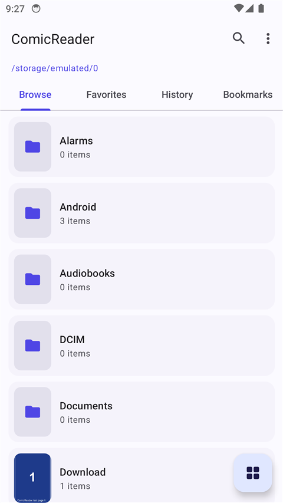
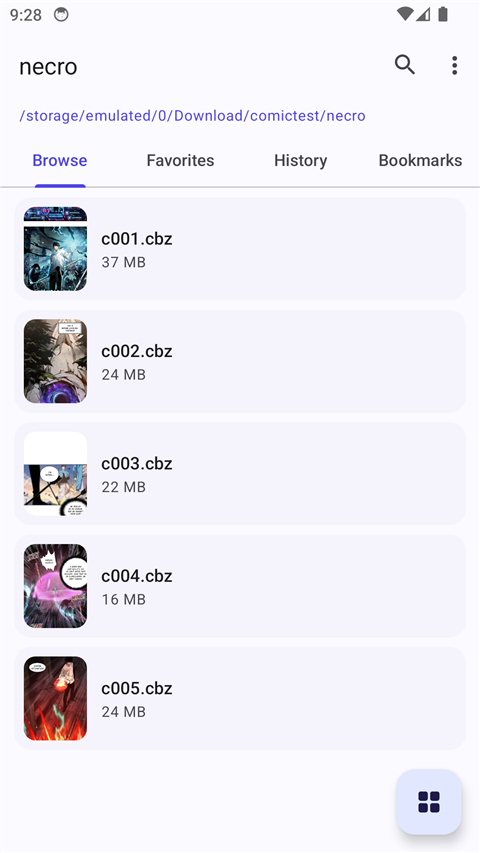
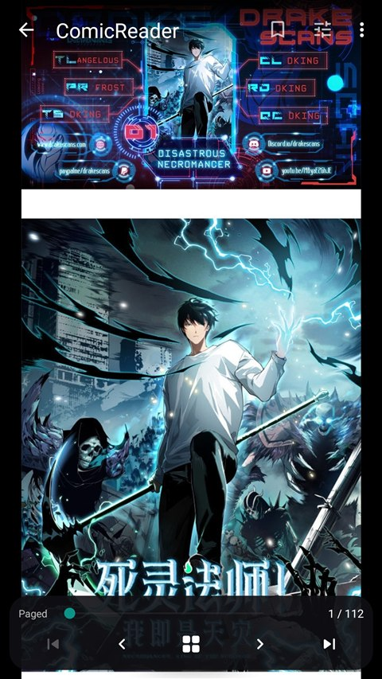
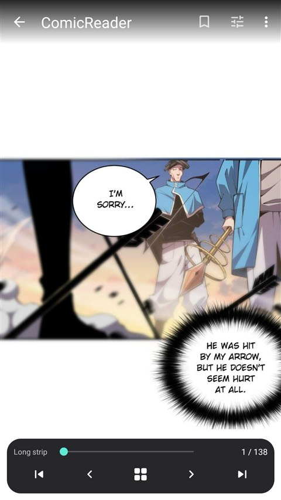
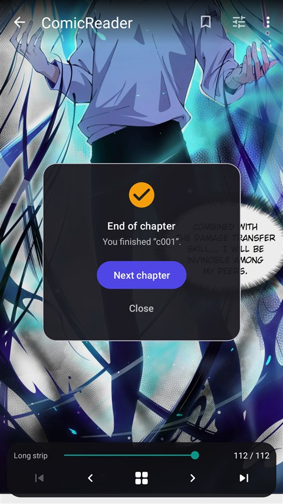
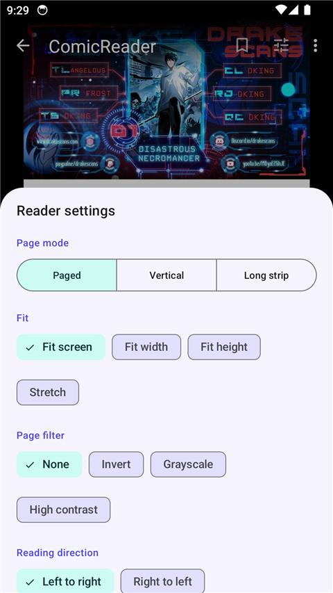
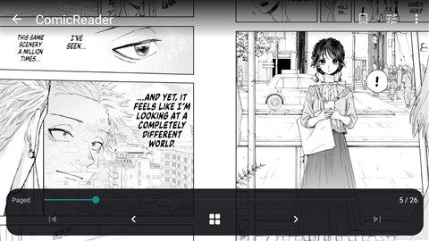
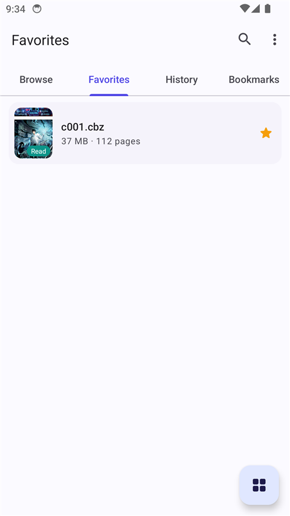
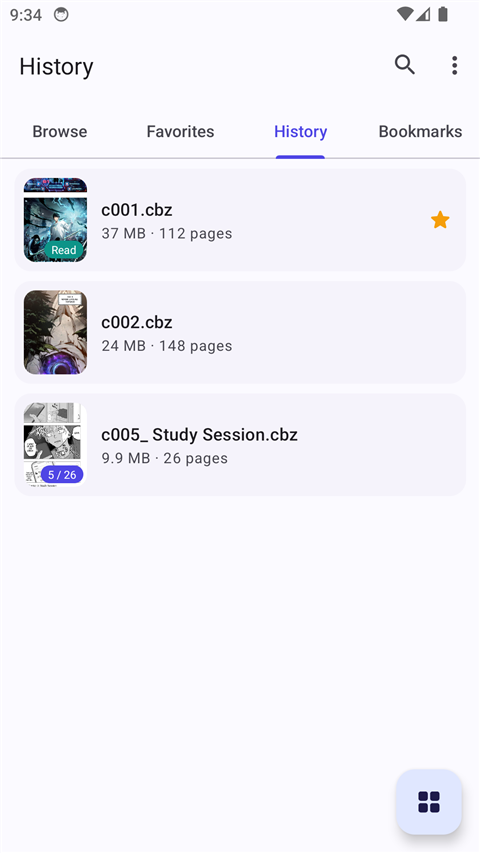
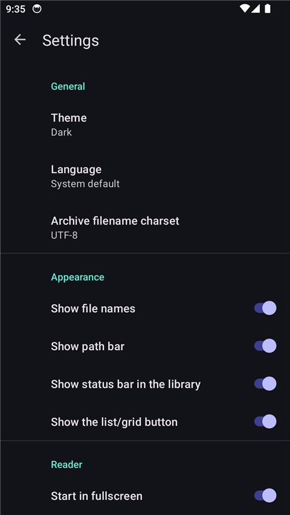

# ComicReader

A clean-room, ad-free comic / PDF reader for Android, written in Kotlin.

This is an **original implementation** built to match the *feature set* of a
reference comic reader — not a copy of its code. No ads, no analytics, no
in-app billing, and no network access.

## Download

Get the latest signed APK from the [**Releases**](https://github.com/infinity6901/ComicReader/releases/latest) page.

## Screenshots

| Library | Chapters | Reader — paged |
|---|---|---|
|  |  |  |

| Reader — long strip (webtoon) | End of chapter | Reader settings |
|---|---|---|
|  |  |  |

| Two-page spread (RTL manga) | Favorites | History |
|---|---|---|
|  |  |  |

| Dark theme — settings |
|---|
|  |

## Features

### File browser
- Browse local storage by folder; list and grid layouts.
- Tabs for **Browse**, **Favorites**, **History** and **Bookmarks**.
- Sort by name / size / date / type (natural number ordering, so `page2` sorts
  before `page10`), ascending or descending.
- Incremental search within the current folder.
- Favorites (star) and reading history, with jump-back to the last page read.
  Tapping a history entry opens the folder that contains that chapter.
- Long-press a file or folder to favorite it, set it as the home folder, open its
  location, rename, mark read/unread or delete it.
- Breadcrumb path bar, quick favorite button, back button navigates up (clamped
  at the root of internal storage).
- Folder rows show "N items · M read"; a folder whose items are all read gets the
  read badge. **Continue reading** jumps to the next unfinished book in a folder,
  and a whole folder can be marked read or unread.
- **Search subfolders** (menu) looks below the current folder, not just in it.
- Opening a book resumes at the last page unless it was already finished.
- Files opened from other apps (`content://`) are copied to the cache and opened.
- Housekeeping: **duplicate file finder** (content-checked), **largest files** list,
  reading **statistics**, and **backup / restore** of your library and settings
  (Settings → Your data) to a JSON file you choose.

### Reader
- **Formats:** images (`jpg`, `jpeg`, `png`, `gif`, `bmp`, `webp`, `avif`) and
  archives `zip`/`cbz`, `rar`/`cbr`, `7z`/`cb7`, plus `pdf`.
- **Page modes:** paged (horizontal swipe), vertical (one page per screen) or
  **long strip** (continuous webtoon scrolling, no gaps).
- **Two-page spread:** facing pages side by side (respects RTL ordering).
- **Page thumbnails:** grid picker to jump straight to any page.
- **Crop:** crop the current page to a PNG.
- **Reading direction:** left-to-right or right-to-left (tap zones follow).
- **Zoom / pan:** pinch-to-zoom, drag to pan, double-tap to zoom or reset.
- **Fit modes:** fit screen, fit width, fit height, stretch.
- **Page filter:** none, invert, grayscale, high contrast, sepia.
- **Auto-scroll** with adjustable speed (continuous in vertical / long-strip modes,
  timed page turns in paged mode); touching the screen takes over.
- **Auto-crop** trims blank page borders; pages ahead are **preloaded**.
- **Chapter list** to jump to any chapter in the folder.
- **Share** or **save** the current page as an image.
- **Per-folder layout:** "Remember layout for this folder" stores mode, direction, fit
  and spread for that folder only.
- **Brightness** overlay (with an optional vertical-drag gesture) and a **night**
  filter.
- **Page spacing** slider for vertical and long-strip modes.
- **Next / previous chapter** buttons, plus an **end-of-chapter card** with a
  direct link to the next chapter. Auto-advance is optional.
- Bookmarks per page, plus a bookmark list to jump between them.
- Go-to-page, orientation lock, rotate, keep-screen-on, immersive fullscreen,
  and tap-to-toggle the UI bars. Volume keys turn pages.
- A reader settings **bottom sheet** exposes the most-used options in place.
- Resumes at the last page read; per-book reading position is stored in history.
- Every reader option is written back to preferences, so the mode, fit, filter,
  brightness, spacing, direction and toggles **persist across chapters and app
  restarts**.

### Settings
- Theme: system / light / dark.
- Per-app language: system, English, 한국어, 日本語, Русский.
- Archive filename charset (UTF-8, CP949, Shift_JIS, GBK, Windows-1251).
- Default reading direction, page mode, fit, filter, page spacing, brightness.
- Gestures (tap zones, volume keys, brightness drag, double-tap zoom).
- File-list options (file names, status bar, breadcrumb, quick button).
- Clear history, clear bookmarks, clear thumbnails, reset all settings.

## Format support mapping

| Extension | Handler | Library |
|---|---|---|
| jpg/jpeg/png/gif/bmp/webp/avif | `ImageSource` | `BitmapFactory` |
| zip / cbz | `ZipSource` | `java.util.zip` |
| rar / cbr | `RarSource` | junrar 8.x (RAR4 and RAR5/7) |
| 7z / cb7 | `SevenZipSource` | Apache Commons Compress |
| pdf | `PdfSource` | platform `PdfRenderer` |

## Project layout

```
app/src/main/java/com/infinity/comicreader/
  App.kt                     application; applies theme + locale
  data/                      Prefs, Library (history/bookmarks/favorites),
                             Thumbs, models
  reader/                    PageSource implementations + factory, Filters,
                             BitmapUtils
  ui/                        ListActivity, ViewerActivity, Settings*, AboutActivity,
                             CropActivity + CropView, PagesActivity + ThumbAdapter,
                             ZoomImageView, PageAdapter, BookAdapter
  util/                      Formats, NaturalOrder, FileUtils/Locales
screenshots/                 README screenshots
```

## Building

Requirements: JDK 17+ (JDK 21 verified) and the Android SDK (platform 34, build-tools 34).

```bash
./gradlew assembleDebug
./gradlew assembleRelease   # signed + R8-minified
```

The debug APK is written to `app/build/outputs/apk/debug/app-debug.apk`, the
release APK to `app/build/outputs/apk/release/app-release.apk`.

On Windows, if JDK 21 is not on PATH:

```powershell
$env:JAVA_HOME = "C:\Program Files\Eclipse Adoptium\jdk-21.0.11.10-hotspot"
$env:PATH = "$env:JAVA_HOME\bin;$env:PATH"
.\gradlew.bat assembleRelease
```

### Release signing

`app/build.gradle.kts` reads `keystore.properties` from the project root and, if
present, signs the release build with `keystore/release.jks`. Both files are
listed in `.gitignore` and **must not be committed**. If `keystore.properties` is
absent the release build still compiles, just unsigned.

Release uses `isMinifyEnabled = true` + `isShrinkResources = true` (R8). The
proguard rules keep junrar and commons-compress whole so the reflection paths in
the archive backends survive minification.

### Prebuilt outputs

`dist/` holds the built artifacts:

| Artifact | Size | Notes |
|---|---|---|
| `ComicReader-1.1-foss-release.apk` | 2.61 MB | v2-signed, R8-minified, offline |
| `ComicReader-1.1-debug.apk` | 7.52 MB | debuggable, unsigned-config |

### Install on a connected device

```bash
adb install -r app/build/outputs/apk/release/app-release.apk
```

Note: the debug and release APKs use different signing keys, so installing one
requires uninstalling the other.

## Permissions

- `READ_MEDIA_IMAGES` (Android 13+) / `READ_EXTERNAL_STORAGE` (≤ Android 12)
- `MANAGE_EXTERNAL_STORAGE` — to browse folders anywhere on internal/external
  storage. The app prompts for "All files access" on first launch.

No internet permission is requested.

## Notes

- `minSdk 26`, `targetSdk 34`.
- AVIF decoding depends on the platform: it works natively on Android 12+
  (API 31+); on older devices AVIF pages may fail to decode.
- The reader decodes pages with `inSampleSize` downsampling to bound memory use,
  then lets `ZoomImageView` scale the result.
- The archive/PDF backends (`SevenZFile`, junrar `Archive`, `PdfRenderer`) keep
  per-instance decode state and are **not thread-safe**. Because the page grid
  loads the current page and its neighbours concurrently, all access to these
  backends is serialized on the source instance (`@Synchronized`).
- Page/thumbnail decode failures are logged (`SevenZipSource`, `RarSource`,
  `PdfSource`, `PageAdapter`, `ThumbAdapter`, `ViewerActivity`) instead of being
  silently swallowed.
- The file browser reloads the current folder on resume, so files added or
  removed outside the app appear without a manual refresh.

## License

Released under the [MIT License](LICENSE).
